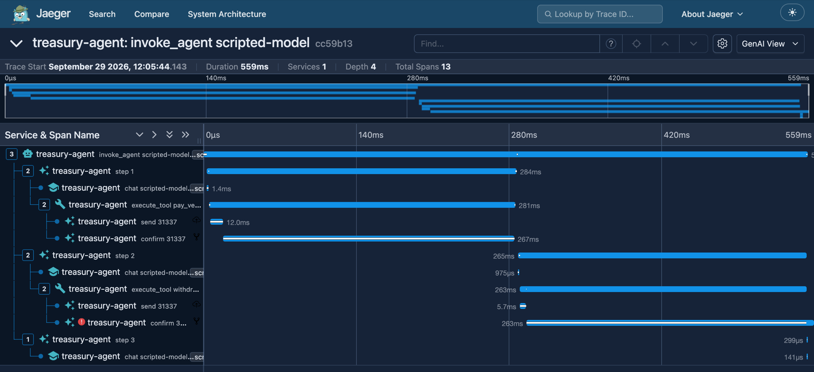

# hashspan

**OpenTelemetry instrumentation for viem, the Coinbase CDP SDK, x402 and MPP.**
Trace the on-chain transactions and payments your AI agents and services send, inside the traces you already have.

<!-- Demo GIF goes here: a short recording of an agent run and its trace in Jaeger. -->

[](https://github.com/selimaytac/hashspan/actions/workflows/ci.yml)
[](https://www.npmjs.com/package/@hashspan/core)
[](LICENSE)

When an agent or a service sends a transaction, its trace usually stops at the call. Whether the transaction was
mined, reverted, or what it cost lives somewhere else. hashspan closes that gap: each transaction becomes a `send` /
`confirm` span pair, keyed by the transaction hash, **inside the trace that sent it**, with status, gas and fees
attached, exported to the backend you already use (Jaeger, Grafana Tempo, Langfuse, Honeycomb, ...).

**Status:** 1.x, published with npm provenance. The API is stable; span, attribute and metric names can still change
in a minor release ([change policy](docs/semconv.md#change-policy)).



<sub>The [example agent](examples/ai-sdk-agent) in Jaeger: a vendor payment and a withdrawal that reverts with a
decoded custom error.</sub>

## Quick start

Requires Node.js 22.3 or later.

```sh
npm install @hashspan/viem @opentelemetry/api viem
npm install @opentelemetry/sdk-node   # unless your app already sets up an OpenTelemetry SDK
```

With an OpenTelemetry SDK started, extend your viem clients (`account`, `to` and `value` are your own):

```ts
import { createPublicClient, createWalletClient, http } from 'viem';
import { base } from 'viem/chains';
import { withHashspan } from '@hashspan/viem';

const hashspan = withHashspan();
const wallet = createWalletClient({ account, chain: base, transport: http() }).extend(hashspan);
const reader = createPublicClient({ chain: base, transport: http() }).extend(hashspan);

// In your agent's tool call or your request handler: the spans join its trace.
const hash = await wallet.sendTransaction({ to, value }); // send span
await reader.waitForTransactionReceipt({ hash }); // confirm span

await hashspan.flush(); // before the process exits
```

Full runnable walkthrough, with the SDK setup and a local chain: [docs/quick-start.md](docs/quick-start.md), or
[on the website](https://hashspan.dev/docs/quickstart).

## Choose your path

| You send with | Start here |
|---|---|
| viem clients | the snippet above, then [`@hashspan/viem`](packages/viem) |
| Coinbase CDP SDK server or smart accounts | [`@hashspan/cdp`](packages/cdp) |
| x402 payments | [`@hashspan/x402`](packages/x402), and the [x402 agent example](examples/x402-agent) |
| MPP payments made with mppx | [`@hashspan/mpp`](packages/mpp) |
| A wallet service (Privy, Turnkey, Circle, ...) | [wallet services](docs/integrations.md#wallet-services) |
| A worker, a wallet backend or a bot, not an agent | [not an agent?](#not-an-agent) |
| A coding agent that adds it for you | [with a coding agent](#with-a-coding-agent) |
| Another send path | [`@hashspan/core`](packages/core) |

## Packages

| Package | Install it when | Status |
|---|---|---|
| [`@hashspan/core`](packages/core) | you record another send path yourself; the adapters bring it along | [](https://www.npmjs.com/package/@hashspan/core) |
| [`@hashspan/viem`](packages/viem) | you send with [viem](https://viem.sh) clients ([viem OpenTelemetry guide](https://hashspan.dev/docs/viem-opentelemetry)) | [](https://www.npmjs.com/package/@hashspan/viem) |
| [`@hashspan/cdp`](packages/cdp) | you send with Coinbase CDP server or smart accounts | [](https://www.npmjs.com/package/@hashspan/cdp) |
| [`@hashspan/x402`](packages/x402) | you pay for APIs with x402 ([x402 tutorial](https://hashspan.dev/docs/x402-tutorial)) | [](https://www.npmjs.com/package/@hashspan/x402) |
| [`@hashspan/mpp`](packages/mpp) | you pay with MPP through mppx (0.x, follows mppx's minor lines) | [](https://www.npmjs.com/package/@hashspan/mpp) |

Install the latest version of each package you use ([versions](docs/releasing.md#versions)). GitHub releases are
tagged per package, so "Latest" there is the package released last.

## Not an agent?

hashspan does not need one: in a payout worker, a wallet backend or a bot, the spans nest under the request or job
span you already have ([services that are not agents](docs/integrations.md#services-that-are-not-agents),
[payout worker example](examples/payout-worker)).

## With a coding agent

[`skills/hashspan`](skills/hashspan/SKILL.md) is an [Agent Skills](https://agentskills.io/specification) skill that
adds hashspan to a TypeScript project, checked in CI: `npx skills add selimaytac/hashspan`. The website has a
[guide for adding hashspan with a coding agent](https://hashspan.dev/docs/build-with-ai).

## Local lab

In a checkout of this repository, `make lab-up` starts Jaeger on `http://localhost:16686` and `make demo` runs the
[example agent](examples/ai-sdk-agent) on a local chain, with no API key ([setup and other targets](CONTRIBUTING.md#local-lab)).
The full set of scenarios, with Grafana dashboards, is in [hashspan-lab](https://github.com/selimaytac/hashspan-lab).

## Why

- **No new dashboard.** It's a library that emits standard OpenTelemetry spans. Your existing backend is the UI.
- **Agent-aware, not agent-only.** Transaction spans nest under your framework's agent and tool spans and carry
  `gen_ai.agent.id`; without an agent, under whatever span is active.
- **Real cost, and metrics.** Fees include the L1 data fee that L2s such as Base charge; latency and fees are also
  recorded as histograms ([semantic conventions](docs/semconv.md)).
- **Small footprint.** `@hashspan/core` has one peer dependency, `@opentelemetry/api`.

## Safe by design

- **It never signs or broadcasts a transaction** and needs no private key ([security model](SECURITY.md#security-model)).
- **Its RPC calls are read-only** ([the requests it adds](docs/architecture.md#json-rpc-requests-hashspan-adds)).
- **Privacy defaults are conservative.** Calldata arguments and error messages are opt-in, and addresses can be hashed
  or dropped ([privacy notes](packages/core#privacy-notes)).

## Documentation

- Website: [hashspan.dev](https://hashspan.dev) · [quick start](https://hashspan.dev/docs/quickstart) · [viem OpenTelemetry guide](https://hashspan.dev/docs/viem-opentelemetry) · [build with AI](https://hashspan.dev/docs/build-with-ai) · [x402 tutorial](https://hashspan.dev/docs/x402-tutorial) · [transaction errors explained](https://hashspan.dev/errors)
- Start: [docs index](docs/README.md) · [Tracing backends](docs/backends.md) · [Integrations](docs/integrations.md) · [Troubleshooting](docs/troubleshooting.md)
- Reference: [Semantic conventions](docs/semconv.md) · [Architecture](docs/architecture.md) · [OpenTelemetry attributes lookup](https://hashspan.dev/learn/otel-attributes)
- Project: [Roadmap](docs/roadmap.md) · [Releasing](docs/releasing.md) · [ADRs](docs/adr/) · [Security](SECURITY.md)

## Contributing

Questions, feedback on the span schema, bug reports and pull requests are all welcome. Start with the
[contributing guide](CONTRIBUTING.md), or pick a
[good first issue](https://github.com/selimaytac/hashspan/issues?q=is%3Aissue+is%3Aopen+label%3A%22good+first+issue%22).

## License

[Apache-2.0](LICENSE)
