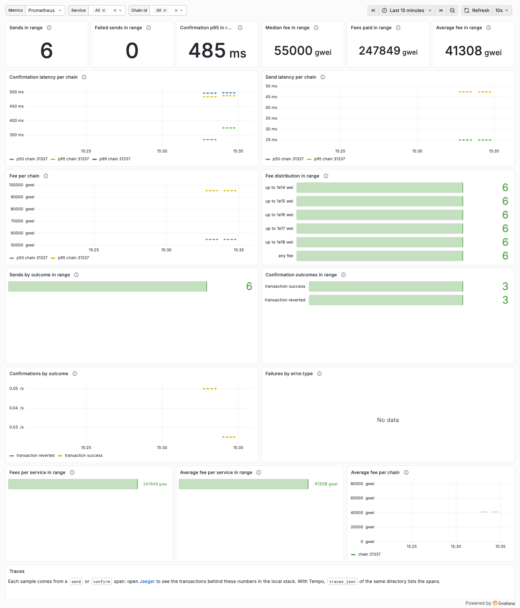

# Tracing backends

hashspan emits standard OpenTelemetry spans and has no exporter of its own: the spans go wherever your
OpenTelemetry SDK exports to. Point the SDK's OTLP exporter at your backend with the standard variables:

```sh
OTEL_EXPORTER_OTLP_ENDPOINT=https://your-backend:4318   # base URL; the HTTP exporter appends /v1/traces
OTEL_EXPORTER_OTLP_HEADERS="key1=value1,key2=value2"     # authentication, if the backend needs it
```

The example agent's setup ([`examples/ai-sdk-agent/src/telemetry.ts`](../examples/ai-sdk-agent/src/telemetry.ts))
uses `@opentelemetry/exporter-trace-otlp-proto`, which reads both. Each setup below was run once with `make demo`;
the hashspan and backend versions tested are listed with each backend. Keep keys out of shell
history and out of the repository, for example with `read -rs KEY` before running the command.

## Console, without a backend

To try hashspan without a backend, let the SDK print each span in the terminal instead of exporting it. `NodeSDK`
reads the standard variable; with the [quick start](quick-start.md):

```sh
OTEL_TRACES_EXPORTER=console npx tsx agent.ts
```

Spans print as they end: `send 31337` and `confirm 31337`, whose `parentSpanContext.spanId` is the `id` of
`pay_vendor`, which prints last; the confirm span's `links` hold the send span's id. Checked with
`@opentelemetry/sdk-node` 0.222.0. Without a backend and without this variable, the exporter cannot connect and the process exits with an
error ([troubleshooting](troubleshooting.md#the-process-exits-with-econnrefused-on-port-4318)).

## Jaeger

The [local lab](../README.md#local-lab) starts Jaeger on `http://localhost:4318`, the exporter's default endpoint, so
`make demo` needs no variables. Open `http://localhost:16686`, pick the `treasury-agent` service and expand
`withdraw_from_vault`.

Without a checkout of this repository, the same Jaeger runs with one command, its UI and OTLP ports bound to
localhost only:

```sh
docker run --rm -p 127.0.0.1:16686:16686 -p 127.0.0.1:4318:4318 jaegertracing/jaeger:2.22.0
```

Tested with Jaeger 2.22.0 against hashspan 1.2.0 on 2026-10-19: every send, confirm, payment, call batch and user
operation shape renders as one tree, with links shown as references. Jaeger 2.21.0 and older label a trace that holds
only a confirm span (its send ran with no parent) as Incomplete, as they count its cross-trace link as a missing parent. When the caller span (for example `execute_tool`) is missing
from a trace, Jaeger 2.21.0 nests each confirm span under the span it only links to (send, payment, batch send or the
replaced confirm), while 2.22.0 shows them as roots.

To search from a terminal, use the v3 query API: in Jaeger 2.22.0 the v1 search `/api/traces?service=` and
`/api/services` answer 404 (not checked in 2.21.0), while `/api/traces/{traceId}` still answers in 2.21.0 and 2.22.0.
The v3 search requires a start time range in RFC 3339:

```sh
curl 'http://localhost:16686/api/v3/traces?query.service_name=my-agent&query.start_time_min=2026-10-05T00:00:00Z&query.start_time_max=2026-10-06T00:00:00Z'
```

## Grafana Tempo

Tested with Tempo 3.0.0 and Grafana 13.2.3, both in Docker, against hashspan 0.5.0 on 2026-10-02.

```sh
OTEL_EXPORTER_OTLP_ENDPOINT=http://your-tempo:4318
```

Tempo accepts OTLP only on the receivers its distributor enables:

```yaml
distributor:
  receivers:
    otlp:
      protocols:
        http:
          endpoint: 0.0.0.0:4318
```

In Grafana, open Explore with the Tempo data source and search for the trace. The reverted `confirm 31337` span is
marked as an error, with every `blockchain.*` attribute in its span attributes. TraceQL can query them, including
across the agent's tool call:

```text
{span.error.type = "reverted"} | select(span.blockchain.tx.revert.reason, span.blockchain.tx.fee)
{span.gen_ai.tool.name = "withdraw_from_vault"} >> {span.blockchain.operation.name = "confirm" && status = error}
```

The second query finds failed confirmations under a given tool. When you call Tempo's search API directly, pass
`start` and `end`: without a time range, Tempo 3.0.0 returned no traces for these queries.

Grafana Cloud takes the same variables with the OTLP endpoint and Basic authentication header shown in your stack's
OpenTelemetry settings; it was not part of this test.

### grafana/otel-lgtm

Tested with `grafana/otel-lgtm` 0.37.0 (Grafana 13.2.3, Tempo 3.1.0, Prometheus 3.15.0) against hashspan 1.1.0 on
2026-10-18. Both files in [dashboards/](../dashboards/README.md) import and every query runs, and the `traces.json`
TraceQL panels return the expected rows on Tempo 3.1.0 (Tempo's search lags ingest by some seconds, so an immediate
query can return none). On the stock image every "in range" panel of `metrics.json` shows 0 for a short-lived process,
because its Prometheus runs without `created-timestamp-zero-ingestion`. Start it with the feature enabled and the
panels match the sends:

```sh
docker run --rm -p 127.0.0.1:3000:3000 -p 127.0.0.1:4318:4318 \
  -e PROMETHEUS_EXTRA_ARGS=--enable-feature=created-timestamp-zero-ingestion grafana/otel-lgtm:0.37.0
```

## Langfuse

Tested with Langfuse 4.49.0, self-hosted with its Docker Compose file, against hashspan 0.9.0 on 2026-10-03.
Langfuse Cloud uses the same API.

```sh
OTEL_EXPORTER_OTLP_ENDPOINT=https://cloud.langfuse.com/api/public/otel   # US: https://us.cloud.langfuse.com/api/public/otel
OTEL_EXPORTER_OTLP_HEADERS="Authorization=Basic $LANGFUSE_AUTH,x-langfuse-ingestion-version=4"
```

`LANGFUSE_AUTH` is `printf '%s:%s' "$PUBLIC_KEY" "$SECRET_KEY" | base64`, from a project's API keys. For a
self-hosted instance the endpoint is `https://your-langfuse/api/public/otel`; plain `http://` (port 3000 by default)
sends the keys unencrypted, so keep it to localhost or a private network. Langfuse accepts OTLP over HTTP only (JSON
or protobuf), not gRPC. See [Langfuse's OpenTelemetry guide](https://langfuse.com/docs/opentelemetry/get-started).

Langfuse maps GenAI spans to its own observation types: `invoke_agent` becomes an agent, `execute_tool` a tool named
after the tool, `chat` a generation. `send`, `confirm` and `payment` spans are plain spans; the reverted confirm span
has level `ERROR`, and its attributes are in the observation's metadata as `attributes.blockchain.*`.

Langfuse stores an attribute string that looks like a number as a number when it can do so without losing precision.
A wei value such as `blockchain.tx.fee` can therefore come back as a number on one span (`40616290500000`) and as a
string on another (`"1234567890123456789"`); take that into account when filtering or exporting.

### With `LangfuseSpanProcessor`

Langfuse's own JavaScript setup, `LangfuseSpanProcessor` from `@langfuse/otel` (as in Langfuse's AI SDK guide),
exports only the spans its default filter `isDefaultExportSpan` keeps: Langfuse's own spans, spans with a `gen_ai.*`
attribute and spans of known LLM instrumentations. It drops the others without an error (it logs them at debug level
only). hashspan's `send`, `confirm`, `payment`, user operation and call batch spans carry `gen_ai.agent.*` attributes
only when an agent identity is set, and its JSON-RPC spans never do. Keep every hashspan span by adding its
instrumentation scopes (`@hashspan/core` and `@hashspan/viem`) to the filter:

```ts
const processor = new LangfuseSpanProcessor({
  shouldExportSpan: ({ otelSpan }) =>
    isDefaultExportSpan(otelSpan) || otelSpan.instrumentationScope.name.startsWith('@hashspan/'),
});
```

Setting an agent identity (the `agent` option of `withHashspan()` or `createTxTracker()`, or the `gen_ai.agent.*`
Baggage entries) also keeps the transaction and payment spans, but not the JSON-RPC spans. Tested with
`@langfuse/otel` 5.11.1.

## Honeycomb

Tested with Honeycomb's free plan, US region, against hashspan 0.5.0 on 2026-10-02.

```sh
OTEL_EXPORTER_OTLP_ENDPOINT=https://api.honeycomb.io   # EU: https://api.eu1.honeycomb.io
OTEL_EXPORTER_OTLP_HEADERS="x-honeycomb-team=$HONEYCOMB_API_KEY"
```

Use an ingest key from your environment's API keys. The spans land in a dataset named after `service.name`
(`treasury-agent` for the example). Attribute types are kept: wei amounts are strings, counts are integers. Query
`WHERE blockchain.tx.status = reverted` and open the trace: the failed `confirm 31337` span sits under
`execute_tool withdraw_from_vault`, and the link to its `send` span shows on the span. Honeycomb also recognizes the
GenAI spans, so the agent span shows its model and token usage. See
[Honeycomb's OpenTelemetry docs](https://docs.honeycomb.io/send-data/opentelemetry/).

## Aspire dashboard, OpenObserve, HyperDX and MLflow

Each was run once against hashspan 1.1.0 on 2026-10-18: spans, parents, names, status, `exception` events and links
arrive complete ([Compatibility](#compatibility) has the counts). The differences are in how the backend stores them:

- Aspire dashboard 13.6.1: returns every attribute as a string (`blockchain.chain.id`, `blockchain.block.number`,
  `blockchain.tx.gas.used`, `server.port`); take that into account when filtering or exporting.
- OpenObserve v1.1.1: returns every attribute as a string and flattens the names (`blockchain.tx.status` is the column
  `blockchain_tx_status`). Its metric names lack `_seconds` (`blockchain_client_send_duration_count`) and carry no
  `job` label, so [`metrics.json`](../dashboards/metrics.json) applies only in part.
- HyperDX 2.41.0 (local mode): returns every attribute as a string (a `Map(String, String)` in ClickHouse).
- MLflow 3.17.1: drops the span kind on OTLP ingest ([mlflow/mlflow#26841](https://github.com/mlflow/mlflow/issues/26841))
  and has no OTLP metrics endpoint (`/v1/metrics` answers 404).

## Compatibility

Each row is one backend version in one run of the backend matrix ([`scripts/backends/`](../scripts/backends/run.mjs)):
a fixed set of spans and metrics is sent over OTLP/HTTP, read back through the backend's own query API and compared
field by field with what was sent. The result file linked in the last column holds the counts and the differences,
grouped. A cell says what the backend stored, not whether that is a bug.

- Corpus `synthetic-1` ([`corpus.mjs`](../scripts/backends/corpus.mjs)): every span kind; string, integer, double,
  boolean and array attributes; an error status with a description; events with attributes; links within and across
  traces and seven links on one span; resource and scope attributes; a 4 KiB value and a non-ASCII one; the three
  [histograms](semconv.md#metrics). It is sent over protobuf and over JSON, each with its own ids.
- Corpus `e7-hashspan-1.1.0-anvil`: what hashspan 1.1.0 sent on Anvil in a one-off experiment on 2026-10-18, seven
  scenarios with 66 to 69 spans over protobuf, compared with the same code. It holds only string and integer
  attributes and no status description, and it was read back without resource and scope, so those cells say so.

To rerun one backend, with Docker and its ports free on 127.0.0.1, then regenerate the table:

```sh
node scripts/backends/run.mjs jaeger   # node scripts/backends/run.mjs --list names the backends
pnpm backends:table
```

The run starts one container named `e13-<backend>` with 2 GiB of memory, its ports bound to 127.0.0.1 and no
directory of the host mounted, and removes the container, its volumes and its image afterwards.

<!-- backends:table:start (generated by `pnpm backends:table`, do not edit) -->

| Backend | Corpus | Spans, names, parents | Kind | Status | Attribute types | Attribute names | Events | Links | Resource / scope | Metrics | Notes | Run |
|---|---|---|---|---|---|---|---|---|---|---|---|---|
| Aspire dashboard 13.6.1 | `e7-hashspan-1.1.0-anvil` | all kept | kept | code kept (no description sent) | **strings** (number sent) | kept | kept | kept (8, 1 across traces) | not read / not read | not read: its telemetry API has no metrics route |  | [2026-10-18](backends/results/aspire@13.6.1.json), http/protobuf |
| HyperDX (local) 2.41.0 | `e7-hashspan-1.1.0-anvil` | all kept | kept | code kept (no description sent) | **strings** (number sent) | kept | kept | kept (8, 1 across traces) | not read / not read | counts exact |  | [2026-10-18](backends/results/hyperdx@2.41.0.json), http/protobuf |
| MLflow 3.17.1 | `e7-hashspan-1.1.0-anvil` | all kept | **dropped** | code kept (no description sent) | kept (number, string) | kept | kept | kept (8, 1 across traces) | not read / not read | refused (404): no OTLP metrics endpoint | span kind dropped on OTLP ingest: [mlflow/mlflow#26841](https://github.com/mlflow/mlflow/issues/26841); link trace ids come back as `tr-<hex>` and resolve | [2026-10-18](backends/results/mlflow@3.17.1.json), http/protobuf |
| OpenObserve 1.1.1 | `e7-hashspan-1.1.0-anvil` | all kept | kept | code kept (no description sent) | **strings** (number sent) | **dots become underscores** | kept | kept (8, 1 across traces) | not read / not read | counts exact: series named without `_seconds`, such as `blockchain_client_send_duration_count` |  | [2026-10-18](backends/results/openobserve@1.1.1.json), http/protobuf |
| grafana/otel-lgtm (Tempo) 0.37.0 | `e7-hashspan-1.1.0-anvil` | all kept | kept | code kept (no description sent) | kept (number, string) | kept | kept | kept (8, 1 across traces) | not read / not read | counts exact | Tempo 3.1.0 and Prometheus 3.15.0 inside | [2026-10-18](backends/results/otel-lgtm@0.37.0.json), http/protobuf |

No backend has a `synthetic-1` result yet: the first lab run of the matrix writes them.

<!-- backends:table:end -->

## Span links

A confirm span links to its send or payment span. Where no span was active at the send, the confirm span is in a
trace of its own and the link is the only relation between them
([troubleshooting](troubleshooting.md#a-confirm-span-with-no-send-span-next-to-it)). Checked with hashspan 0.9.0 on
2026-10-04, unless noted:

| Backend | Keeps span links | How it was checked |
|---|---|---|
| Jaeger 2.22.0 | yes | hashspan 1.2.0, 2026-10-19: `/api/traces/{traceId}` returns each link as a `FOLLOWS_FROM` reference with the link's own trace id |
| Jaeger 2.21.0 | yes | both query APIs return the link: `/api/v3/traces` as an OTLP link, `/api/traces` as a `FOLLOWS_FROM` reference |
| Grafana Tempo 3.0.0 | yes | `/api/v2/traces/{traceId}` returns the link; how Grafana shows it was not checked |
| Langfuse 4.49.0 | no | no link in the observations API (`/api/public/v2/observations`) or in its storage; see [langfuse/langfuse#12337](https://github.com/langfuse/langfuse/issues/12337) |
| Honeycomb | yes | the link shows on the span (hashspan 0.5.0, 2026-10-02, [above](#honeycomb)) |
| Aspire dashboard 13.6.1 | yes | hashspan 1.1.0, 2026-10-18: the telemetry API returns every link, including the cross-trace link of `watch()` |
| Grafana Tempo 3.1.0 (in otel-lgtm) | yes | hashspan 1.1.0, 2026-10-18: same check, no link differs |
| OpenObserve v1.1.1 | yes | hashspan 1.1.0, 2026-10-18: the links are a JSON string column |
| HyperDX 2.41.0 | yes | hashspan 1.1.0, 2026-10-18: the `Links.*` columns in ClickHouse |
| MLflow 3.17.1 | yes | hashspan 1.1.0, 2026-10-18: the link's trace id is rewritten to `tr-<hex>` and resolves |

## Span metrics and HTTP instrumentation

With HTTP instrumentation next to `traceTransport()` (for example `@opentelemetry/instrumentation-undici`), each
JSON-RPC span gets an HTTP client child span. A span-metrics generator such as Tempo's counts both as client calls of
the service (`eth_*` and `POST`), so a RED panel that sums client calls counts each request twice. Filter on
`rpc.system.name` or on the span name there. The nesting is described under [JSON-RPC spans](semconv.md#spans).

## Common questions

Where each question is answered, with the metrics on Prometheus or the spans in a trace backend:

| Question | Where |
|---|---|
| How long do confirmations take, per chain? | The dashboard's latency panels; in PromQL, `histogram_quantile(0.95, sum by (le, blockchain_chain_id) (rate(blockchain_client_confirmation_duration_seconds_bucket[5m])))` |
| How many transactions revert, per chain? | The dashboard's outcome panel; in PromQL, `sum by (blockchain_chain_id) (rate(blockchain_client_confirmation_duration_seconds_count{blockchain_tx_status="reverted"}[5m]))` |
| Why did they revert, and under which tool or job? | The TraceQL queries under [Grafana Tempo](#grafana-tempo): `blockchain.tx.revert.reason` on the confirm span, the tool or job span above it |
| Did a sampler or a process exit lose spans? | Metrics are recorded for every transaction whatever the sampler decides; compare their counts with the traces ([many transactions](../packages/viem/README.md#many-transactions)) |
| Did a retried paid request pay twice, or pay without the task succeeding? | [Payment, request and task outcomes](../packages/x402/README.md#payment-request-and-task-outcomes) |
| What did a transaction cost? | `blockchain.tx.fee` on the confirm span, in wei, or in the token `blockchain.tx.fee_asset` names; see its row in [semantic conventions](semconv.md#attributes) for what it includes |

## Grafana dashboard for the metrics

hashspan's tracker records three histograms ([metrics](semconv.md#metrics)): send duration, confirmation duration and
fee. [`dashboards/metrics.json`](../dashboards/metrics.json) is a ready Grafana dashboard for them, on a Prometheus
data source: confirmation and send latency percentiles per chain, fees per chain and per service (median, total,
average) and their distribution, and the outcomes of sends and of the confirmations of transactions, user operations
and call batches, each with its own outcome attribute ([metrics](semconv.md#metrics)), with service and chain id
filters. The fee panels show the fees the senders paid in the native currency: samples with `blockchain.fee.payer`
(a payment's facilitator, a paymaster, a sponsor) or `blockchain.fee.denomination` (a fee paid in a token) are left out. [`dashboards/traces.json`](../dashboards/traces.json) lists the spans behind them in
[Grafana Tempo](#grafana-tempo); [dashboards/](../dashboards/README.md) describes both files and their variables.



In the local lab, `make lab-metrics` starts Prometheus (with its OTLP receiver) and Grafana with `metrics.json`
provisioned; `make demo` then sends the example agent's metrics to Prometheus, and the dashboard is on
`http://localhost:3000`. Tested with Prometheus 3.15.0 and Grafana 13.2.3. For a ready stack that shows the dashboards
with data from many scenarios, see [hashspan-lab](https://github.com/selimaytac/hashspan-lab). To use the dashboard
elsewhere, send the metrics over OTLP to a Prometheus-compatible backend and import the file:

- Prometheus needs `--web.enable-otlp-receiver` and turns `blockchain.client.send.duration` (unit `s`) into
  `blockchain_client_send_duration_seconds` and attributes into labels such as `blockchain_chain_id` and
  `error_type`, as in [`docker/prometheus.yml`](../docker/prometheus.yml).
- The counts for the selected range (sends, failures, outcomes, fees, the fee distribution) are the rise of each
  counter within the range, without the extrapolation of `increase()`, which turns a short run into fractional or
  inflated counts. They are exact when each process is a series of its own that starts at zero: give each run its
  own `service.instance.id`, as the example agent does, and, for a process that exports only once before it exits,
  let Prometheus add a zero sample at each series' start (`--enable-feature=created-timestamp-zero-ingestion`,
  enabled in the lab). A long-running process restarted under the same `service.instance.id` resets its counters,
  and the counts then miss the sends before the restart.
- The dashboard's data source is a variable at its top: pick your Prometheus data source there.

